# TOUCHSTONE

**Secure by Design Commitment Verification Platform: an independent scorecard of the evidence behind vendor security commitments.**

> *Measure the commitment. Not the claim.*

<p align="center"></p>

Hundreds of software manufacturers have signed CISA's [Secure by Design Pledge](https://www.cisa.gov/securebydesign/pledge): seven goals, from multi-factor authentication to issuing accurate CVE records. A signature is public, but progress mostly is not, or the signers report it themselves. TOUCHSTONE asks a narrower question that public evidence can actually answer. **What does public evidence show about each commitment, and what can it not show?** It reads public sources and measures only what they support. Every number links to the records and query behind it, the goals that cannot be checked from outside are labelled as such, and every result is saved as a run anyone can reproduce byte for byte.

**Try it:** the whole app runs as a static site with the bundled synthetic demo: [het-p301204.github.io/touchstone](https://het-p301204.github.io/touchstone/). You can also run it locally in two commands (see [Installation](#installation)).

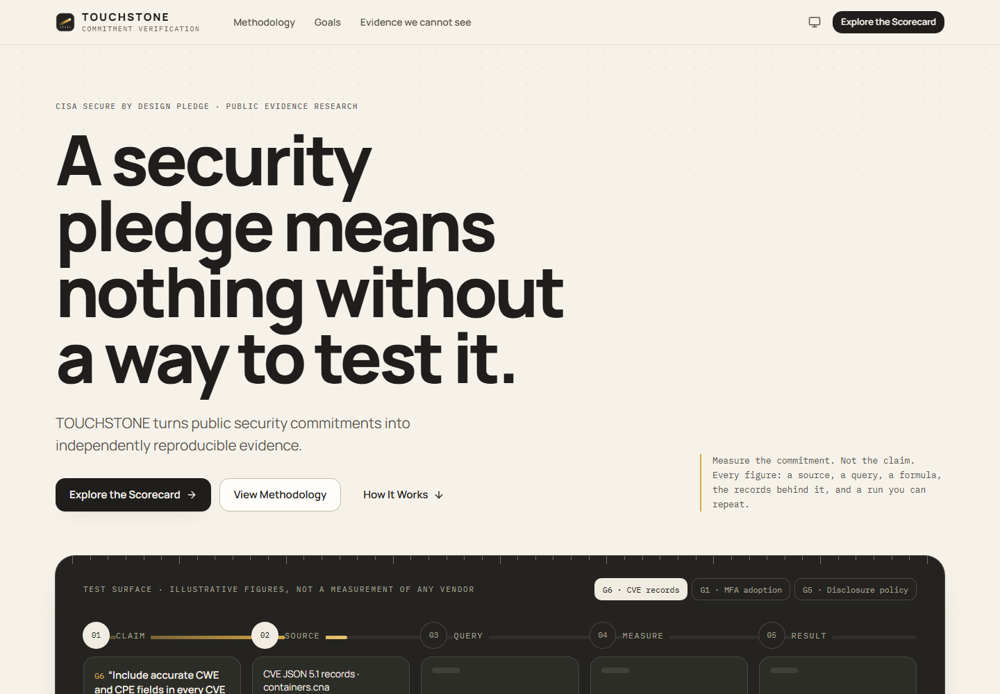

### A vendor profile: what can be measured, what cannot, and how much evidence stood behind it
Every figure stands alone: there is no composite score. The ring is evidence *coverage*, not security strength. Four goals are *not externally verifiable* for every vendor, and that is shown, never scored.

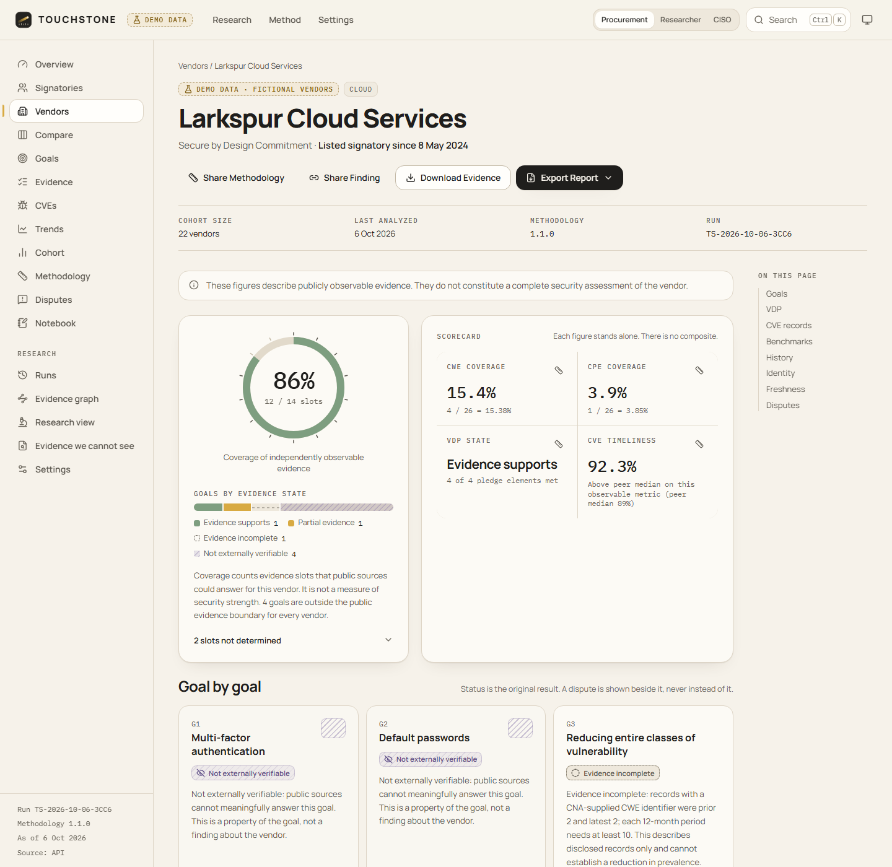

### "How was this calculated?" is on every metric
The figure, the formula with the numbers substituted, the eligible records, the exact query over the snapshot, the methodology version, the run id and the outputs hash.

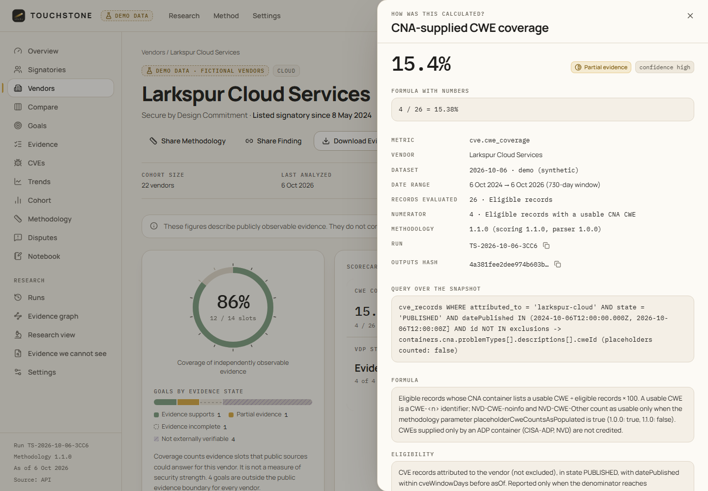

<table>
<tr>
<td width="50%"><b>Evidence we cannot see</b>: no score is not a failing score<br>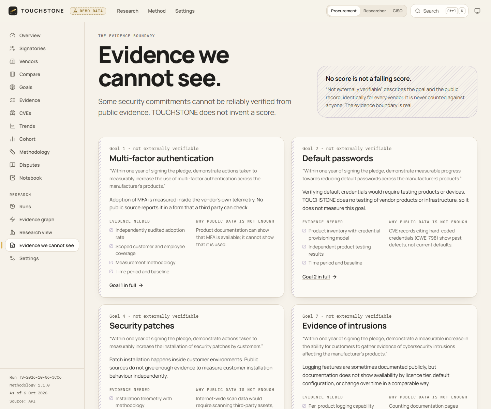</td>
<td width="50%"><b>Whose data is it?</b> The manufacturer's CNA container is credited; third-party enrichment is shown and never credited<br>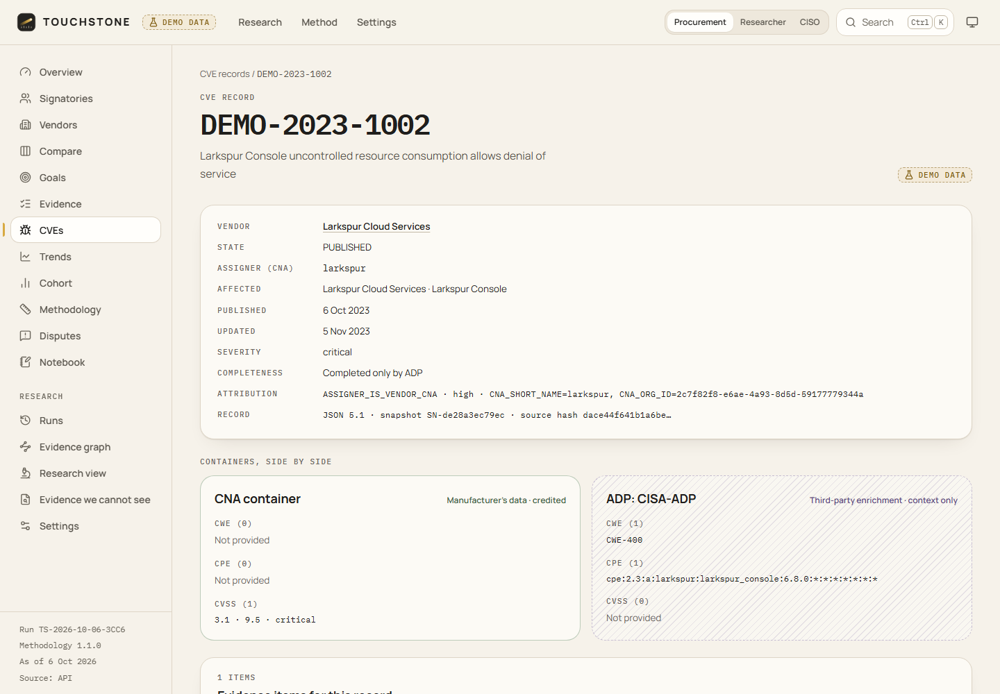</td>
</tr>
<tr>
<td><b>Reproduce a run in the browser</b>: same snapshots and same methodology give the same outputs hash<br>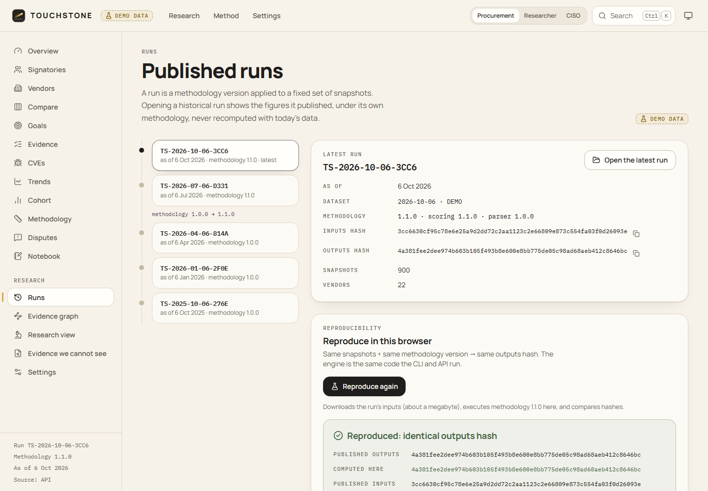</td>
<td><b>Compare</b>: "stronger publicly observable evidence on the measured dimensions", never "more secure"<br>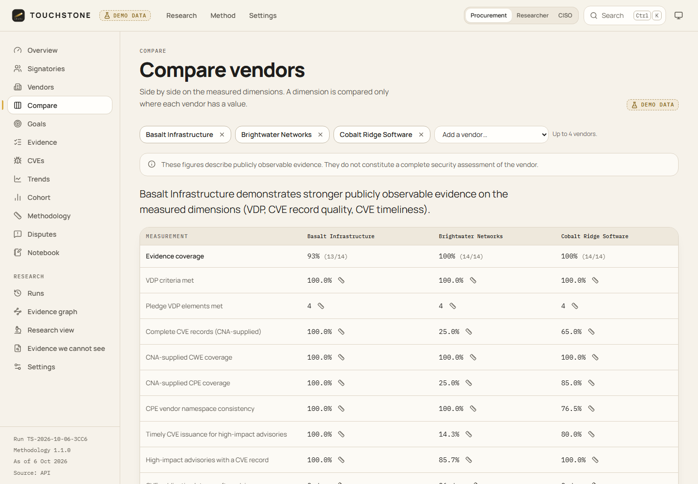</td>
</tr>
<tr>
<td><b>Overview</b>: coverage distribution, record quality, VDP states, largest changes, the run's stage log<br>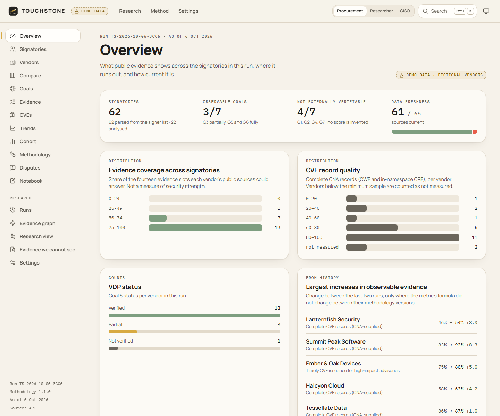</td>
<td><b>Evidence leaderboard</b>: you choose the column to sort by; there is no overall rank<br>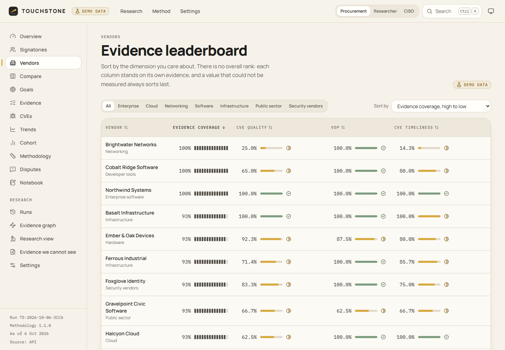</td>
</tr>
<tr>
<td><b>Disputes</b>: a challenge overlays a finding and never overwrites it; history is append-only<br>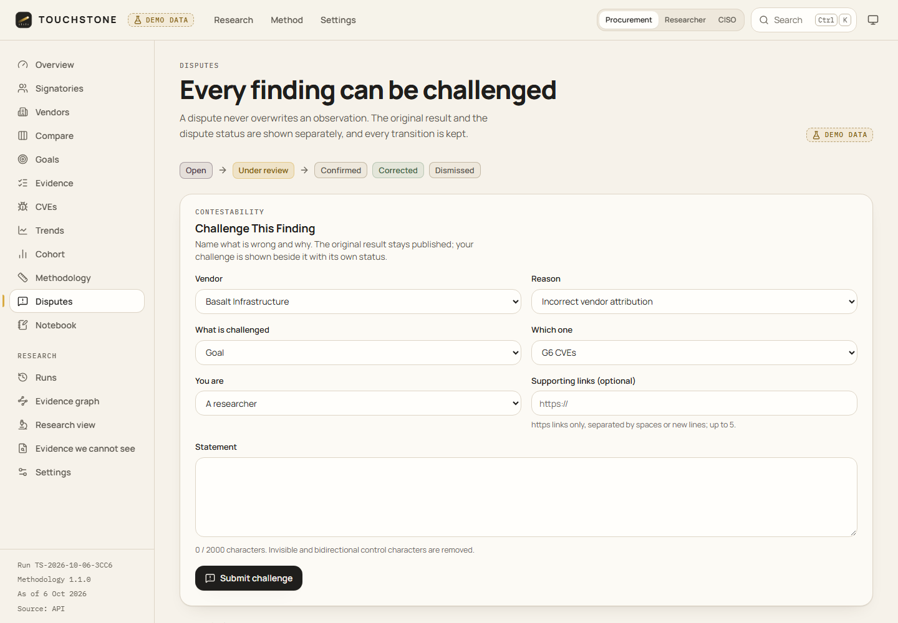</td>
<td><b>Trends</b>: methodology version changes are marked on the axis<br>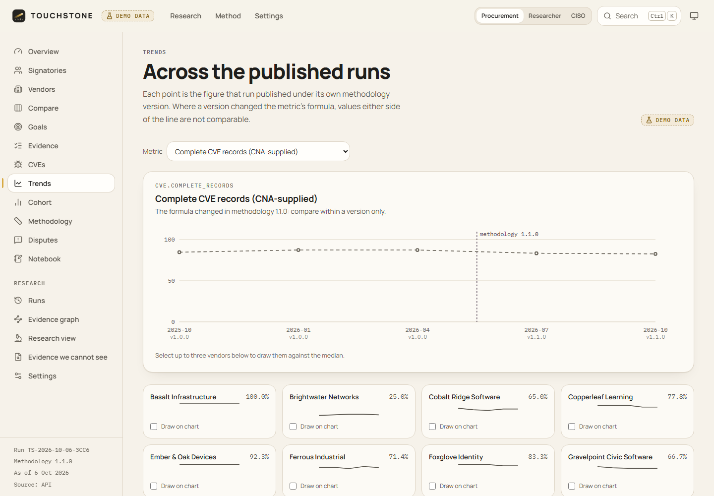</td>
</tr>
<tr>
<td><b>Evidence graph</b>: vendor to product to CVE to CWE and CPE, VDP and advisories<br>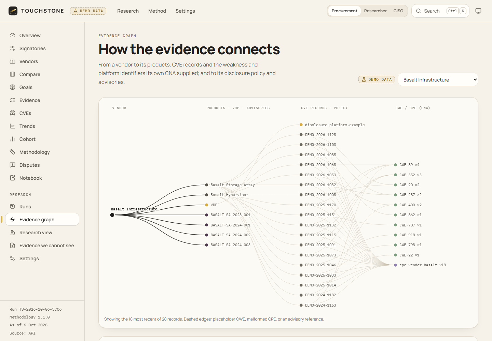</td>
<td><b>Dark mode</b>: graphite, not black-and-neon<br>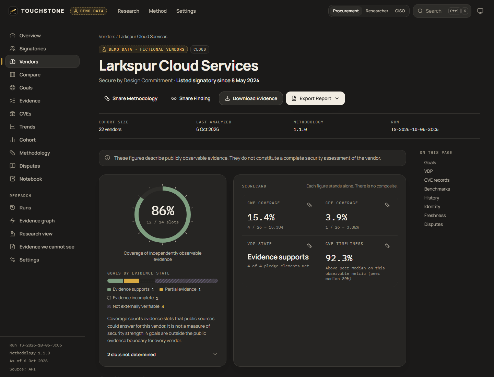</td>
</tr>
<tr>
<td colspan="2"><b>Phone</b>: the profile restacks vertically and nothing scrolls sideways<br>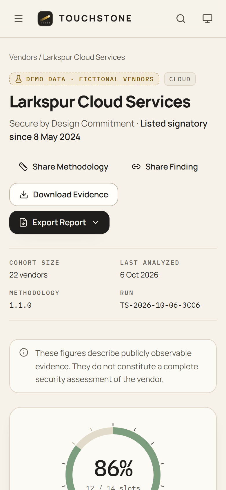</td>
</tr>
</table>

All screenshots show the real production build serving the **synthetic demo cohort**: 22 fictional vendors, `.example` domains, `DEMO-` record ids. No figure in this repository describes a real company. The screenshots are captured by `node scripts/screenshots.ts`.

## Contents

1. [Why it exists](#why-it-exists)
2. [The problem](#the-problem)
3. [What it measures](#what-it-measures)
4. [What it cannot measure](#what-it-cannot-measure)
5. [Methodology](#methodology)
6. [Data sources](#data-sources)
7. [Reproducibility](#reproducibility)
8. [Evidence model and disputes](#evidence-model-and-disputes)
9. [Architecture](#architecture)
10. [Demo](#demo)
11. [Installation](#installation)
12. [Testing](#testing)
13. [Security](#security)
14. [Limitations](#limitations)
15. [Roadmap](#roadmap)

## Why it exists

A pledge is a promise. TOUCHSTONE is not a vendor security rating, an attack-surface scanner or a compliance certificate. It is an evidence system for measuring the publicly observable part of a public commitment. It keeps four things separate:

1. what can be measured independently,
2. the evidence behind each measurement,
3. what cannot be verified from outside, and
4. how vendors compare on the measurable part.

Every conclusion can be re-run by someone else.

Its defining rules:

- **UNKNOWN is never PASS.** A policy page that could not be fetched is not a policy without a safe harbor. A vendor with no machine-readable advisory feed has not issued zero timely CVEs. Unmeasurable values are `null` with a stated reason, never 0 and never 100.
- **NOT EXTERNALLY VERIFIABLE is never NON-COMPLIANT.** It describes the goal and the public evidence boundary, identically for every vendor.
- **No composite security score.** Each dimension stands alone with its own numerator, denominator and formula.
- **No verdicts about vendors.** TOUCHSTONE never calls a vendor compliant, secure, insecure or failed. A quality check scans every generated sentence for those words.

## The problem

- **Self-reported progress is not evidence.** A vendor's own post about MFA adoption cannot be checked by anyone outside the vendor.
- **Aggregators blur who did the work.** A CVE record can look complete on NVD because CISA's Vulnrichment program added the CWE and CPE. The pledge asks the *manufacturer* to include them. In CVE JSON 5.x the manufacturer's data sits in the CNA container (`containers.cna`), and third-party additions sit in `containers.adp[]`. Crediting the enrichment would measure the enricher.
- **"Unknown" quietly becomes "pass" or "fail"** in most scorecards.
- **One number per vendor hides which commitment it describes** and how much evidence stood behind it.

## What it measures

| Goal | What TOUCHSTONE measures | Headline figure |
|---|---|---|
| **G5** Vulnerability disclosure policy | Eight criteria read from the vendor's public policy and security.txt. They include the four elements the pledge names: a reporting channel, testing authorized, a good-faith safe harbor, and public disclosure allowed. Each determination quotes the sentence behind it. A negated sentence ("safe harbor does not apply") contradicts a criterion; it never satisfies it. | Criteria met; pledge elements met (0 to 4) |
| **G6** CVE record quality | The share of the vendor's CVE records whose **CNA container** has a real CWE and a well-formed CPE in the vendor's namespace. Third-party enrichment is reported separately and never credited. | Complete records (%) |
| **G6** CVE issuance timeliness | For the vendor's critical and high CSAF advisories: whether every listed CVE exists and was published within the tolerance, plus the publication latency. The tolerance is 1 day, a TOUCHSTONE methodology parameter, not a CISA threshold. | Timely issuance (%) |
| **G3** Vulnerability classes (partial) | The share of disclosed records in tracked weakness classes (memory safety, injection, authentication and credentials), latest 12 months against the prior 12. It is a signal, never a verification. | Change in percentage points |

## What it cannot measure

| Goal | Why not |
|---|---|
| **G1** Multi-factor authentication | Adoption lives in the vendor's telemetry. Documentation shows that MFA exists, not that it is used. |
| **G2** Default passwords | Checking would mean testing products. TOUCHSTONE tests nothing. |
| **G4** Patch installation | Installation happens in customer environments. Measuring it would mean scanning third-party assets. |
| **G7** Intrusion evidence | Logging documentation does not show availability by licence tier, the defaults, or change over time. |

These goals are labelled **Not externally verifiable**, each with the list of evidence that *would* answer it. Vendor statements about them are shown as self-reported claims, never as evidence.

## Methodology

The full methodology, with every formula, eligibility rule, status rule and VDP phrase rule, is in **[docs/methodology.md](docs/methodology.md)**. In short:

- **Goal status by written rule:** VERIFIED, PARTIAL, NOT_VERIFIED, NOT_EXTERNALLY_VERIFIABLE or DATA_ERROR, with DISPUTED shown as an overlay. Goal 3 is never VERIFIED. G6 needs every eligible record complete (the pledge says *every*) and enough high-impact advisories.
- **Missing data is a first-class state.** A gap is recorded as not provided, placeholder, malformed, no eligible records, below the minimum sample, no source, or source failed. Policy retrieval is recorded as read, too short, unreadable (a script-only page), fetch failed, or not found.
- **Minimum samples:** 5 eligible records for each CVE metric, 5 high-impact advisories before timeliness can verify a goal, 10 records per period for Goal 3, and 80 words before a policy can verify Goal 5.
- **Confidence** (HIGH, MEDIUM or LOW) is lowered only by named rules: name-only attribution, a small sample, a stale or unknown source age, a carried-forward observation, or a short policy.
- **Evidence coverage** counts how many of 14 evidence slots public sources could answer for a vendor. It describes observability, not quality.
- **Benchmarks** use rates and medians only, so vendor size doesn't dominate. Peers are listed signatories, and a position needs at least 3 peers. The wording is careful: "Above peer median on this observable metric."
- **Anomalies are observed deviations,** each reported with the rule that fired: unusually low values against the cohort, latency outliers against the vendor's own history, VDP changes (with before and after), and data-quality flags.
- **A ten-question quality gate** runs before publication. It asks: is the identity right, is the data current enough, is the denominator correct, are missing values explicit, could the conclusion be overstated, and five more.
- **Versioned.** Methodology 1.1.0 stopped counting `NVD-CWE-noinfo` placeholders as a CWE. Runs made under 1.0.0 keep their 1.0.0 figures, and trend charts mark the change.

## Data sources

| Source | Used for | Kept |
|---|---|---|
| CISA Secure by Design Pledge signer page | who has signed (the parser reads the page's own count and checks it against the names) | raw |
| CVE Program records (`cveawg.mitre.org`) | every CVE metric | raw |
| NVD CVE API 2.0 | listing a vendor's CVE ids by CNA org id | raw |
| Vendor CSAF 2.0 advisories | issuance timeliness | raw |
| Vendor security.txt (RFC 9116) | contact, policy link, expiry | raw |
| Vendor VDP pages (robots.txt respected) | the eight VDP criteria | extracted text locally; only quoted sentences published |

Every fetch is a recorded snapshot. A failed refresh is recorded too. When an older snapshot is used instead, the substitution is named and the source's freshness reflects the snapshot actually used, never the attempt. Terms of use, rate limits and retention are in [docs/data-sources.md](docs/data-sources.md).

**Live collection is real.** It has been run end to end against live public sources for one signatory. That run fetched the CISA signer list, NVD enumeration by CNA org id, CVE records, security.txt and the linked policy page: 70 snapshots, all successful. It then scored them with the same engine. The vendor registry for that run is in [`fixtures/live/`](fixtures/live/). The results stay on the machine that collects them and are not published in this repository.

## Reproducibility

A run is one methodology version applied to one fixed set of snapshots. The engine is pure: no clock, no randomness, no I/O. That is enforced by lint rules. Each run publishes its inputs, an `inputsHash` (which covers a fingerprint of every methodology parameter) and an `outputsHash`:

```
$ node apps/cli/src/main.ts reproduce TS-2026-10-06-3CC6
Run              TS-2026-10-06-3CC6   dataset 2026-10-06   methodology 1.1.0
Published hash   4a381fee2dee974b603b105f493b8e600e8bb775de05c98ad68aeb412c8646bc
Reproduced hash  4a381fee2dee974b603b105f493b8e600e8bb775de05c98ad68aeb412c8646bc
Inputs hash      3cc6630cf95c78e6e25a9d2dd72c2aa1123c2e66809e873c554fa03f0d26093e
Time             184 ms
REPRODUCED identical outputs from the run’s own inputs and methodology. Nothing was fetched.
```

The same check runs in the browser (Runs page, "Reproduce") and through `POST /api/runs/:id/reproduce`. Opening a historical run shows the figures it published under its own methodology, never a recalculation against today's data. `npm run demo:check` regenerates the whole demo dataset and every published file in memory, and fails on any byte of difference.

## Evidence model and disputes

Every number points at evidence items. Each item records:

- the vendor, the metric, the source, and the snapshot it was read from;
- the subject (a CVE id or a policy URL);
- the exact fields extracted, including which CVE container they came from;
- how the methodology interpreted them: supports, does not support, excluded, or context;
- a one-sentence reading;
- a confidence;
- the methodology version.

Evidence ids are content-derived, so identical inputs produce identical ids on every re-run.

Vendor identity is explicit. Legal name, brand, signer-list name, CNA short name and org id, CPE vendor namespace, and advisory domain are each a separate alias with its own evidence and confidence. A CVE is attributed to a vendor only from structured fields (the assigning CNA, or the affected vendor together with a CPE in the vendor's namespace), never from free text. Ambiguous or conflicting identities are excluded and listed, never merged.

Anyone can **challenge a finding**: a product mapping, a vendor attribution, a CVE mapping, an outdated or missing source, or the methodology itself. A dispute shows as DISPUTED next to the original result and never overwrites it. It moves through OPEN, UNDER REVIEW, and then CONFIRMED, CORRECTED or DISMISSED. Database triggers enforce that the history is append-only, and a correction appears only in a later run. See [docs/disputes.md](docs/disputes.md).

## Architecture

```
Public sources -> Collectors (SSRF-safe fetch) -> Snapshots (content-addressed)
  -> Normalization -> Identity resolution -> Measurement engine -> Evidence ledger
  -> Assessment layer (status, coverage, cohort, anomalies, quality gate)
  -> Published bundle -> REST API / web application / CLI
```

| Package | Role |
|---|---|
| `packages/core` | The engine: goal model, methodology versions, normalizers, identity and attribution, VDP assessment, metrics, assessments, evidence, runs, publication, reports (JSON, Markdown, CSV, PDF). Deterministic; runs unchanged in Node and the browser. |
| `packages/collect` | Collectors, the SSRF-safe fetcher, the content-addressed snapshot store, the demo loader. Node only. |
| `apps/api` | REST API (Hono) with SQLite (`node:sqlite`) for disputes, the research notebook and refresh jobs. |
| `apps/web` | React web app. It works against the API or, as a static site, against the published bundle. |
| `apps/cli` | The `touchstone` command line: run, reproduce, export, methodology, goals, collect. |

TypeScript runs directly on Node 24 through type stripping, so the server, CLI and engine have no build step. Details, including the published bundle layout and the API endpoint table, are in [docs/architecture.md](docs/architecture.md).

## Demo

The bundled cohort is **22 fictional vendors over five quarterly dataset versions** (2025-10-06 to 2026-10-06). It goes through the real normalizers and engine, from raw CVE JSON, CSAF, security.txt and HTML policy files. Each vendor exists to exercise one scenario:

- complete records;
- missing CWE, and missing or malformed CPE;
- placeholder CWEs, whose figures drop under methodology 1.1.0;
- heavy third-party enrichment;
- duplicate and conflicting records, ambiguous attribution, and an alias collision after an acquisition;
- strong, weak, prohibitive and absent policies;
- an expired security.txt;
- a policy whose scope narrows between versions;
- no advisory feed;
- a stale source;
- a failed fetch carried from the previous snapshot;
- a vendor below the minimum sample.

The full scenario table with expected outcomes is in [docs/demo-data.md](docs/demo-data.md), and a test checks that every one still holds.

## Installation

Requirements on Windows, macOS and Linux: **Node.js 24 or later** and npm. Nothing else: no `make`, no compiler, and no database server, because SQLite is built into Node.

```bash
git clone https://github.com/het-P301204/touchstone.git
cd touchstone
npm ci
npm run build
npm start
```

Then open http://127.0.0.1:8787. By default the server binds to loopback, uses the bundled synthetic data, makes no network requests, and keeps administration disabled. Every setting is an optional environment variable, documented in [`.env.example`](.env.example).

For development, run `npm run dev:api` and `npm run dev` in two terminals and open http://localhost:5173. With Docker, run `docker compose up --build`.

The command line:

```bash
node apps/cli/src/main.ts goals
node apps/cli/src/main.ts run --dataset demo --version 2026-10-06
node apps/cli/src/main.ts export northwind-systems --format pdf --out northwind.pdf
```

Live collection makes network requests and must be asked for explicitly:

```bash
node apps/cli/src/main.ts collect --live --vendor <id> --registry fixtures/live/registry.example.json --out .touchstone/live/<id> --enumerate-nvd --max-cves 60
```

## Testing

```bash
npm test            # all Vitest suites
npm run lint
npm run typecheck
npm run demo:check  # committed demo data equals what the generator and engine produce
npm run verify      # all of the above plus the production build
npm run test:e2e    # Playwright journeys against the production build (after npm run build)
```

On 2026-10-06, `npm test` passed **629 tests**:

| Suite | Tests | What it covers |
|---|---:|---|
| `packages/core` | 183 | normalizers, identity, VDP rules, metrics, assessments, evidence, runs, reports |
| `packages/collect` | 95 | the SSRF-safe fetcher (injected resolver and transport), collectors, the demo loader |
| `apps/api` | 75 | every endpoint, the dispute lifecycle, admin-disabled behaviour, body caps, rate limits |
| `apps/cli` | 12 | every command, exit codes, terminal escape stripping |
| `apps/web` | 18 | UI logic: gap wording, status vocabulary, data access |
| `tests/adversarial` | 125 | an adversarial review of the engine: every defect it found, plus every attack already handled |
| `tests/security` | 112 | a security review: SSRF, parser hardening, the API, CLI and web |
| `tests/regression` | 9 | methodology fingerprints, and every published run re-executed against its expected manifest |

`npm run test:e2e` adds **8 Playwright journeys**: the signature journey from profile to formula, query and run; in-browser reproduction with the published hash; the language rule on every main page; a dispute that overlays and does not replace a finding; axe WCAG 2 AA checks; and no sideways scrolling on a phone.

Two independent reviews ran before release. An adversarial engine review found 24 defects that the original tests had passed, among them a policy that refused all four pledge elements but was rated VERIFIED, and a failed CVE source that showed as 0% timeliness. A security review found 3 medium and 5 low issues. All of them are fixed, and each one stays in the suite as a `DEFECT` or `FINDING` test.

## Security

TOUCHSTONE fetches untrusted content and shows it to people who make decisions from it. The main defences:

- **Outbound requests** go through one fetcher. It allows https on port 443 only, to an allowlist of hosts taken from the vendor registry and never from fetched data. It checks every resolved address against private and special ranges, pins the connection to the checked address, re-validates each redirect, and caps size, time and content type.
- **Parsing** is linear-time and depth-limited, and nothing fetched is ever executed. Invisible and bidi characters are stripped, and reports guard against CSV formula and Markdown injection.
- **The API** binds to loopback and refuses to start on another interface without a Host allowlist, which blocks DNS rebinding. It sends a strict CSP, caps bodies before reading them, and rate limits per client (IPv6 by /64) with server-wide hourly ceilings. Its administrative endpoints sit behind one constant-time-compared token and are disabled when no token is set.
- **CI actions** are pinned by commit SHA, the container base image by digest, and the gitleaks binary is checksum-verified.

See [SECURITY.md](SECURITY.md) and [docs/threat-model.md](docs/threat-model.md).

## Limitations

- **Four of seven goals cannot be measured** from public evidence, and Goal 3 only partially.
- **A policy is read, not tested.** VDP criteria come from documented phrase rules. Unusual wording can be missed, and every determination is quoted so it can be checked and disputed.
- **A disclosed vulnerability is not prevalence.** An undisclosed vulnerability cannot be counted.
- **CPE namespace consistency depends on the registry.** For example, a CNA may write a vendor string that differs from the NVD dictionary's. That makes the registry a disputable decision carried with evidence. TOUCHSTONE does not yet validate CNA CPEs against the official CPE dictionary.
- **Timeliness needs a machine-readable advisory feed (CSAF).** Without one, it is not measured.
- **Live runs start fresh.** They carry no history from earlier live runs yet, so change detection and historical baselines apply only to the demo series.

More in [docs/limitations.md](docs/limitations.md).

## Roadmap

- Validate CNA-supplied CPEs against the official CPE dictionary.
- Carry history and previous VDP observations across live runs, for change detection on real data.
- Support advisory formats beyond CSAF (OSV, vendor RSS) for the timeliness dimension.
- Add a reviewer workflow for registry decisions (alias additions with evidence) alongside disputes.
- Schedule live refreshes, with freshness alerts.

## License

Apache-2.0. CVE records are © The MITRE Corporation and used under the CVE Program terms of use. CISA and NVD content is a work of the U.S. Government. See [docs/data-sources.md](docs/data-sources.md).
