# TOUCHSTONE architecture

TOUCHSTONE is a TypeScript monorepo (npm workspaces) that runs directly on Node 24 through type stripping: the API,
CLI, scripts and engine have no compile step. Only the web app is bundled (Vite).

## Pipeline

```mermaid
flowchart LR
  subgraph PUB[Public sources]
    CISA[CISA signer page]
    CVE[CVE Services API<br/>cveawg.mitre.org]
    NVD[NVD CVE API 2.0<br/>id enumeration only]
    CSAF[Vendor CSAF 2.0 feeds]
    STXT[security.txt]
    VDP[VDP policy pages]
  end
  subgraph COL[Collectors - packages/collect]
    SF[safeFetch<br/>SSRF-safe, pinned DNS]
    COLL[collectors/*.ts]
  end
  SNAP[(Snapshots<br/>content-addressed store)]
  subgraph CORE[Engine - packages/core, pure]
    NORM[Normalization<br/>normalize/, text/, vdp/]
    ID[Identity resolution<br/>identity/]
    MEAS[Measurement engine<br/>measure/]
    LED[Evidence ledger<br/>evidence/]
    ASS[Assessment layer<br/>assess/, run/quality-gate]
    RUN[Run + publication split<br/>run/, publish/]
  end
  BUNDLE[(Published bundle<br/>JSON files)]
  API[REST API<br/>apps/api]
  WEB[Web application<br/>apps/web]
  CLI[CLI<br/>apps/cli]

  PUB --> SF --> COLL --> SNAP --> NORM --> ID --> MEAS --> LED --> ASS --> RUN --> BUNDLE
  BUNDLE --> API --> WEB
  BUNDLE --> WEB
  BUNDLE --> CLI
```



| Stage | What happens | Module |
|---|---|---|
| Public sources | CISA signer list, CVE JSON 5.x records, NVD (to enumerate CVE ids only), vendor CSAF advisories, security.txt, VDP pages. See [data-sources.md](data-sources.md). | |
| Collectors | One fetch becomes one recorded snapshot (OK, FAILED or REJECTED). Every outbound request goes through `safeFetch`. | `packages/collect/src/safe-fetch.ts`, `ip.ts`, `robots.ts`, `collectors/*.ts`, `live.ts` |
| Snapshots | Content-addressed store: raw bytes under `<root>/snapshots/<sha256>` for RAW sources, an append-only `index.jsonl`, extracted text under `<root>/extracts/` for EXTRACT_ONLY policy pages. Snapshot id = `SN-` + 12 hex of sha256 over (sourceId, url, content sha256). | `packages/collect/src/store.ts`, `packages/core/src/normalize/snapshot-id.ts` |
| Normalization | CVE JSON 5.0-5.2, CSAF 2.0, RFC 9116 security.txt, the CISA signer page, hardened HTML-to-text, VDP criterion assessment. Untrusted JSON is read through own-property accessors with size caps. | `packages/core/src/normalize/*.ts`, `text/html.ts`, `vdp/assess.ts`, `util/sanitize.ts` |
| Identity resolution | Alias normalization, identity-conflict detection, CVE attribution rules and exclusions, signatory matching. | `packages/core/src/identity/index.ts` |
| Measurement engine | Metric computation with gaps, minimum samples and confidence rules. | `packages/core/src/measure/*.ts` |
| Evidence ledger | One content-addressed evidence item per record per metric, per VDP criterion, per advisory per metric. Id = `EV-` + 10 hex of sha256 over the canonical JSON of the item (a counter suffix disambiguates a prefix collision). | `packages/core/src/evidence/ledger.ts` |
| Assessment layer | Goal status, dimension figures, coverage, cohort benchmarks, anomalies, VDP change detection, freshness, the 10-question quality gate. | `packages/core/src/assess/*.ts`, `freshness/freshness.ts`, `run/quality-gate.ts` |
| Run and publication | `executeRun` produces a `RunOutput` with a manifest; `splitForPublication` cuts it into a summary and per-vendor detail files. | `packages/core/src/run/run.ts`, `publish/split.ts` |
| Web application | React app that reads the same published shapes from the static bundle or from the API. | `apps/web/src` |

The method behind each number is in [methodology.md](methodology.md).

## Monorepo layout

```
packages/
  core/       @touchstone/core     the engine: model types, goals, methodology versions, normalizers, identity,
                                   VDP assessment, measures, assessments, evidence ledger, runs, publication split,
                                   reports (JSON, Markdown, CSV, PDF). Pure and deterministic; runs in Node and the browser.
  collect/    @touchstone/collect  Node only: safeFetch, IP classification, robots.txt, snapshot store, collectors,
                                   live orchestrator, demo dataset loader.
apps/
  api/        @touchstone/api      Hono REST API on node:http, SQLite (node:sqlite) for disputes, notebook, refresh jobs.
  cli/        @touchstone/cli      `touchstone` command line.
  web/        @touchstone/web      React 19 + Vite + Tailwind single-page app.
scripts/
  demo/generate.ts                 deterministic synthetic dataset generator (fixtures/demo)
  demo/vendors.ts                  the fictional vendor specifications
  build-demo.ts                    runs the pipeline over every demo dataset version and writes the published bundle
  smoke.ts                         smoke test against a running server
  docs/vdp-rules-table.ts          prints the VDP rule tables used in docs/methodology.md
fixtures/
  demo/                            synthetic raw snapshots, registry, expected run manifests (see demo-data.md)
  real/                            a few unmodified public documents for normalizer tests (see PROVENANCE.md)
  live/registry.example.json       an example registry for live collection
tests/
  adversarial/                     cross-module adversarial tests (Vitest)
  security/                        security review tests (Vitest)
  regression/methodology.test.ts   pins each methodology version's fingerprint and every published run's manifest
  e2e/journeys.spec.ts             Playwright journeys against the production build (playwright.config.ts)
packages/*/test, apps/api/test, apps/cli/test, apps/web/src/**/*.test.ts   unit and integration tests (Vitest)
```

The engine purity rules are enforced by ESLint on `packages/core/src` (see [CONTRIBUTING.md](../CONTRIBUTING.md)).

## Run model

A **run** is one methodology version applied to one fixed set of inputs (`RunInputs`): mode, dataset version, `asOf`,
methodology version, vendors, CVE records, advisories, VDP observations, previous VDP observations, snapshots, sources,
history and the signer-list parse result.

- **Canonical JSON** (`run/canonical.ts`): object keys sorted by UTF-16 code unit, no whitespace, `undefined` members
  omitted. Every hash below is a sha256 over this form.
- **Methodology fingerprint** (`methodologyFingerprint`): the first 16 hex of a sha256 over the methodology version,
  all of its parameters, and its parser and scoring versions.
- `inputsHash` = sha256 over a canonical projection of the inputs: the methodology fingerprint plus every input field,
  where each top-level array is replaced by the sorted list of its elements' canonical JSON (vendors first have their
  aliases, alias evidence, claims and domains put in canonical order). The order of records, snapshots or registry
  entries never changes the hash, and editing a parameter changes it even when the version string does not.
- `runId` = `TS-<asOf date>-<first 4 hex of inputsHash, upper case>`, for example `TS-2026-10-06-3CC6`.
- `outputsHash` = sha256 over the canonical JSON of the methodology, parser and scoring versions and the methodology
  fingerprint, plus vendors, evidence, attributions, exclusions, identity conflicts, freshness and cohort. The same
  inputs under a different methodology always give a different hash.
- **Stages** recorded in the manifest, each OK / WARN / FAILED / SKIPPED with a detail line: `FETCH`, `SNAPSHOT`
  (substitutions), `NORMALIZE`, `IDENTITY`, `VALIDATE` (conflicting duplicates, missing dates), `MEASURE`, `SCORE`,
  `EVIDENCE`, `PUBLISH` (quality gate result).
- `qualityChecks`: the ten pre-publication checks (Q1-Q10).
- `reproduceRun(inputs, manifest)` re-executes and compares `runId`, `datasetVersion`, `asOf`, the three versions,
  `inputsHash`, `outputsHash` and `snapshotIds`.

`executeRun` is pure: no clock, no randomness, no I/O. Inputs are put in canonical order on entry (vendors and their
alias lists, records, sources, snapshots; advisories de-duplicated by vendor and id), so input order does not change
the outputs. When several VDP observations exist for a vendor, the one with the latest `observedAt` (then the lowest
snapshot id) is used.

`tests/regression/methodology.test.ts` pins each methodology version's fingerprint and re-executes every published
demo run from its published inputs against `fixtures/demo/expected/<runId>.manifest.json` (same run id, `inputsHash`
and `outputsHash`). Changing a formula or a parameter without adding a methodology version fails it.

## Published bundle

Layout from `packages/core/src/model/publish.ts`, under `apps/web/public/data/` (copied into `apps/web/dist/data/` by
the web build):

| File | Shape | API equivalent |
|---|---|---|
| `index.json` | `RunIndex`: mode, latest run id, every run with dataset version, asOf, methodology version and both hashes, `builtFrom` | `GET /api/runs` |
| `runs/<runId>/summary.json` | `RunSummary`: manifest, methodology version object, goals, metric definitions, one `VendorSummary` per vendor (goals with metrics but without per-record evidence ids, dimensions, coverage, benchmarks, anomalies, VDP observation and changes, counts), cohort, freshness, sources, source-level snapshots plus every snapshot that is not OK, per-source snapshot counts, identity conflicts, exclusion count, signer-list counts | `GET /api/runs/:id` |
| `runs/<runId>/vendors/<vendorId>.json` | `VendorDetail`: goal assessments with evidence ids, evidence items, CVE records (attributed and excluded-with-this-vendor-as-candidate), attributions, exclusions, advisories, per-record snapshots | `GET /api/vendors/:id/evidence?run=` |
| `history.json` | `HistorySeries[]`: per vendor, per metric, one point per run with its methodology version | `GET /api/vendors/:id/history` (filtered) |
| `inputs/<datasetVersion>.json` | `RunInputs` of that run, for reproduction | `GET /api/runs/:id/inputs` |
| `disputes.json` | `Dispute[]` synthetic seeds | seeded into SQLite; `GET /api/disputes` |
| `notebook.json` | `NotebookEntry[]` synthetic seeds | seeded into SQLite; `GET /api/notebook` |

`scripts/build-demo.ts` also writes `fixtures/demo/expected/<runId>.manifest.json` for every run.

## API

Hono application in `apps/api/src/app.ts`. Every response error uses one envelope `{ error: { code, message,
details? } }`; no stack trace leaves the process. Reads are served from the bundle loaded once at start; no read
recomputes a run.

| Method | Path | Access | What it returns |
|---|---|---|---|
| GET | `/api/health` | public | Status, data mode, refresh mode, latest run, DB state, whether administration is enabled. 503 when degraded. |
| GET | `/api/signatories` | public | Signatory directory for a run. Query: `run`, `category`, `status`, `coverageMin`, `coverageMax`, `q`/`search`, `synthetic`, `sort` (name, coverage, vdp, cve_quality, cve_timeliness, cves), `order`, `limit` (<= 500), `offset`. Nulls sort last. |
| GET | `/api/vendors/:id` | public | Vendor summary for a run, active disputes overlaying it, the runs the vendor appears in. |
| GET | `/api/vendors/:id/goals` | public | Each goal with its assessment, `originalStatus`, `displayState` (DISPUTED when an active dispute applies) and active dispute ids. |
| GET | `/api/vendors/:id/evidence` | public | The vendor detail file. Optional `metric` and `interpretation` filters. |
| GET | `/api/vendors/:id/history` | public | History series for the vendor, optional `metric`. |
| GET | `/api/cves` | public | CVE list for a run. Query: `run`, `vendor`, `year`, `severity`, `cwe`, `product`, `completeness` (COMPLETE, MISSING_CWE, MISSING_CPE, MISSING_BOTH, ENRICHED_ONLY), `limit`, `offset`. |
| GET | `/api/cves/:id` | public | One record with its attributions and exclusions. |
| GET | `/api/goals` | public | The seven goals and the metric definitions. |
| GET | `/api/methodology` | public | Methodology versions with the runs made under each. |
| GET | `/api/runs` | public | The run index. |
| GET | `/api/runs/:id` | public | The run summary (`latest` accepted). |
| GET | `/api/runs/:id/inputs` | public | The run's inputs. |
| POST | `/api/runs/:id/reproduce` | public; 30/hour per client and 120/hour server-wide; one at a time with up to 4 queued (429 `REPRODUCE_BUSY` beyond) | Re-executes the run from its published inputs and compares hashes. Nothing is fetched. |
| GET | `/api/freshness` | public | Freshness table, snapshot status counts, substitutions. |
| GET | `/api/reports/:vendorId` | public | Vendor report, `format` = json, markdown (md), csv or pdf, as an attachment. |
| GET | `/api/disputes` | public | Disputes with history. Query: `vendor`, `run`, `status`, `limit`, `offset`; `X-Total-Count` header. |
| POST | `/api/disputes` | public; 10/hour per client and 200/hour server-wide | Create a dispute (JSON). The target must exist in the named run for that vendor. |
| GET | `/api/disputes/:id` | public | One dispute with its allowed transitions. |
| POST | `/api/disputes/:id/transition` | admin token | Move a dispute along `DISPUTE_TRANSITIONS`. |
| GET | `/api/notebook` | public | Research notebook, optional `vendor`, `tag`. |
| POST | `/api/notebook` | admin token | Append a notebook entry. |
| POST | `/api/refresh` | admin token | Start a refresh job (DEMO replay or LIVE collection, see below). 202. One job at a time. |
| GET | `/api/refresh` | public | Current job id and the last 10 jobs. |
| GET | `/api/refresh/:jobId` | public | One job with its stage log. Server filesystem paths are shown as variable names or `<path>`. |

Middleware order: request id and structured log, security headers, Host check, then for `/api/*` CORS, the general
rate limit (300 per minute per client by default; IPv4 by address, IPv6 by /64), the streaming body cap, and the JSON-only rule for POST
bodies. Details are in [threat-model.md](threat-model.md).

In `--production` (or `NODE_ENV=production`) the API also serves the built web app from `apps/web/dist` on the same
origin, with an SPA fallback for client routes.

## Static-site mode and API mode

The web app has one data-access interface (`apps/web/src/data/source.ts`) with two adapters returning the same
published shapes:

- **StaticSource** reads `${BASE_URL}data/...` files. Disputes submitted in the static site are saved in the browser's
  localStorage only and marked "this browser only". Reports are rendered in the browser from the engine. Refresh is not
  available; the UI replays the recorded stage log instead.
- **ApiSource** calls `/api/...`. Disputes go to the server; reports are rendered by the server; an admin can start a
  refresh with the bearer token.

At start the app probes `GET /api/health` once (1.5 s timeout). If it answers with `ok`, the API is used; otherwise the
static bundle. `?source=static` forces the static adapter.

In both modes, **reproduce** can run in the browser: the app fetches the run's inputs, lazy-loads the engine and calls
`reproduceRun`. GitHub Pages hosts the static mode (`npm run build:pages`, base path `/touchstone/`, a `404.html` copy
of `index.html` for deep links).

## Demo mode and live mode

| | Demo (default) | Live |
|---|---|---|
| Data | Synthetic vendors and records under `fixtures/demo` | Public sources for vendors in a registry file |
| Network | None | Outbound HTTPS through `safeFetch` only |
| CLI | `touchstone run --dataset demo --version <date>` | `touchstone collect --live --vendor <id> --registry <file> --out <dir>` (refuses without `--live`) |
| API refresh | `TOUCHSTONE_MODE=demo`: `POST /api/refresh` replays the fixtures through FETCH (read files, verify sha256), NORMALIZE, VALIDATE (compare with published inputs), SCORE, PUBLISH (compare `outputsHash` with the published run). It never overwrites the bundle. | `TOUCHSTONE_MODE=live` plus `TOUCHSTONE_LIVE_REGISTRY`: FETCH runs the live collector; the run manifest and inputs are written under `TOUCHSTONE_LIVE_OUT/runs/<runId>/`. PUBLISH is SKIPPED: a live run is reviewed offline and never published automatically. |
| Labels | Every vendor `synthetic: true`; the UI and reports label them | `synthetic: false` |

The live collector module is imported lazily, only when a live refresh or `collect --live` actually runs
(`apps/api/src/engine.ts`, `apps/cli/src/main.ts`).

## Storage

The API keeps what changes between runs in SQLite (`node:sqlite`, no native module), file `.data/touchstone.db` by
default or `:memory:`. Published run data is never stored there. Schema (`apps/api/src/store.ts`, migration 1):

| Table | Holds |
|---|---|
| `schema_version` | applied migrations |
| `disputes` | one row per dispute: vendor, target, run, reason, role, statement, evidence URLs, status, created, synthetic |
| `dispute_events` | append-only audit history: at, from, to, actor, note, corrected-in run |
| `dispute_transitions` | the allowed transitions, mirrored from `DISPUTE_TRANSITIONS` at start |
| `notebook_entries` | append-only research notebook |
| `refresh_jobs` | refresh jobs with their stage log and result |

Triggers enforce integrity inside the database:

| Trigger | Effect |
|---|---|
| `dispute_events_no_update`, `dispute_events_no_delete` | dispute history is append-only |
| `disputes_no_delete` | disputes are never deleted |
| `disputes_fields_immutable` | only a dispute's `status` may change |
| `disputes_status_follows_history` | `status` may only be set to the latest event's `to_status` |
| `dispute_events_legal` | an event must start from the current status (or be the first event, to OPEN) and the step must be in `dispute_transitions` |
| `notebook_no_update`, `notebook_no_delete` | notebook entries are append-only |

Jobs left QUEUED or RUNNING by a previous process are recorded as FAILED at start ("Interrupted"), never forgotten.
The file database uses WAL journaling and a 5 s busy timeout.

## Performance choices

- **Precomputed runs.** The bundle holds finished runs. The API loads it once and answers reads from memory; the static
  site needs no server at all.
- **Per-vendor detail files.** Evidence, records and per-record snapshots live in one file per vendor per run and are
  loaded on demand (the API keeps a bounded in-memory cache of them). The summary carries only what the overview, directory,
  comparison and profile header need.
- **Lazy inputs.** Run inputs (between 0.76 MB and 1.18 MB per demo version as built today) are fetched only when someone reproduces a run;
  the engine itself is lazy-loaded in the browser for that.
- **Lazy engine on the server.** The API imports the engine modules only for reproduce, reports and refresh, so reads
  keep working even if an engine module fails to load.
- **Linear parsers.** HTML-to-text, CPE splitting, robots.txt matching and signer-page parsing are single forward scans
  with bounded work per character; untrusted arrays are truncated to fixed maxima.
